<picture>
  <source media="(prefers-color-scheme: dark)" srcset="assets/header-dark.svg">
  
</picture>

<picture>
  <source media="(prefers-color-scheme: dark)" srcset="assets/label-projects-dark.svg">
  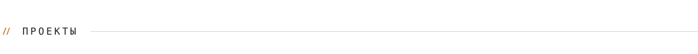
</picture>

<a href="https://github.com/don-qu1xote/six-feat"><picture><source media="(prefers-color-scheme: dark)" srcset="assets/card-sixfeat-dark.svg"></picture></a><a href="https://github.com/don-qu1xote/morph"><picture><source media="(prefers-color-scheme: dark)" srcset="assets/card-morph-dark.svg"></picture></a>

<a href="https://github.com/don-qu1xote/pdr"><picture><source media="(prefers-color-scheme: dark)" srcset="assets/card-pdr-dark.svg"></picture></a>

<picture>
  <source media="(prefers-color-scheme: dark)" srcset="assets/label-stack-dark.svg">
  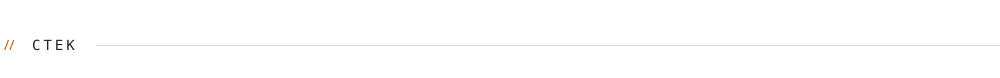
</picture>

<picture>
  <source media="(prefers-color-scheme: dark)" srcset="assets/stack-dark.svg">
  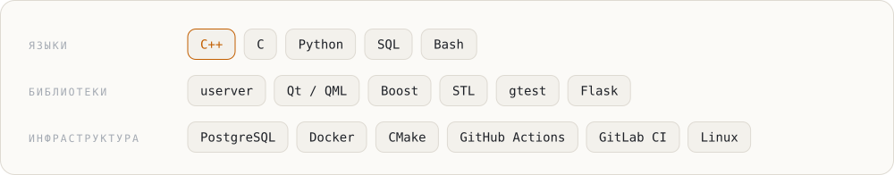
</picture>

<picture>
  <source media="(prefers-color-scheme: dark)" srcset="assets/label-contacts-dark.svg">
  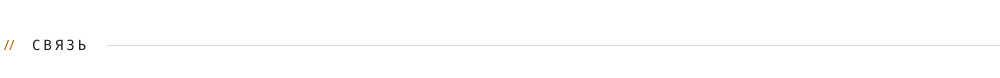
</picture>

<a href="https://t.me/A_12_11_4_17"><picture><source media="(prefers-color-scheme: dark)" srcset="assets/btn-telegram-dark.svg">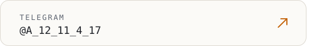</picture></a><a href="https://leetcode.com/u/don_qu1jote"><picture><source media="(prefers-color-scheme: dark)" srcset="assets/btn-leetcode-dark.svg">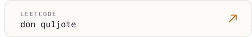</picture></a>

<picture>
  <source media="(prefers-color-scheme: dark)" srcset="assets/footer-dark.svg">
  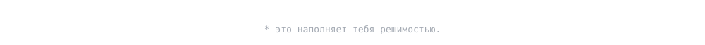
</picture>
